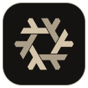

<p align="center">
    
</p>

<p align="center">
    Personal <strong>NixOS</strong> configuration managed with Flakes, <code>flake-parts</code>, <code>import-tree</code>, and Home Manager.
</p>

<h2> Architecture</h2>

- Modular `flake-parts` configuration under `modules/`, auto-imported via `import-tree` and grouped into `nixos` and `home` topic buckets in `modules/host.nix`.
- Dynamic Material You theming generated from `env.wallpaper` via `matugen`.
- Host-specific identifiers, paths, and secrets kept out of the repository via `/etc/nixos/env.nix` (overriding `env.nix`), while hardware configuration uses `/etc/nixos/hardware-configuration.nix` when present and falls back to `hardware-vm.nix`.

<h2> Usage</h2>

Configure `/etc/nixos/env.nix`, then rebuild and switch using `nh`:

```bash
# apply
nh os switch . -- --impure

# test
nh os test . -- --impure
```
